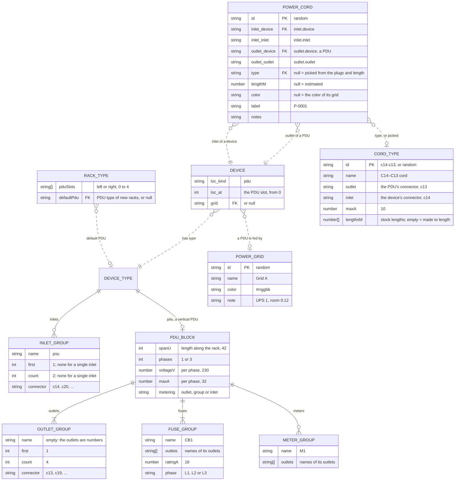
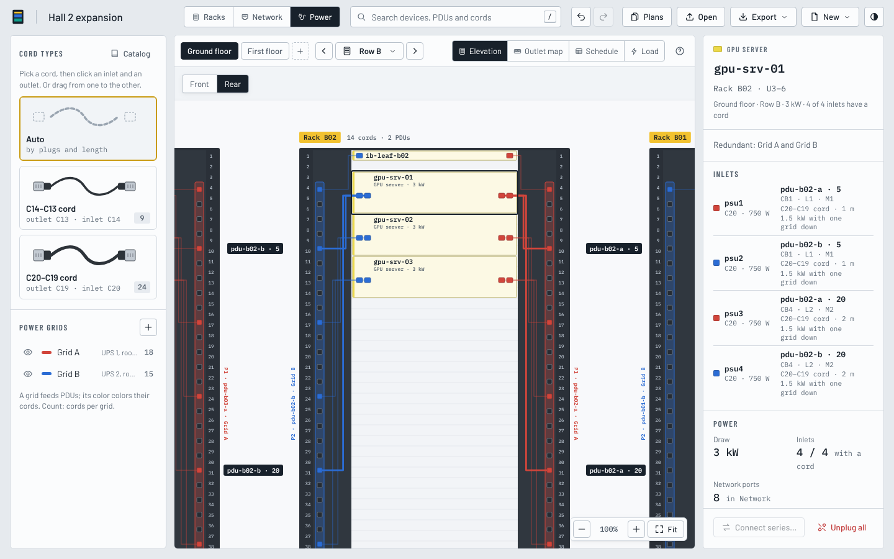
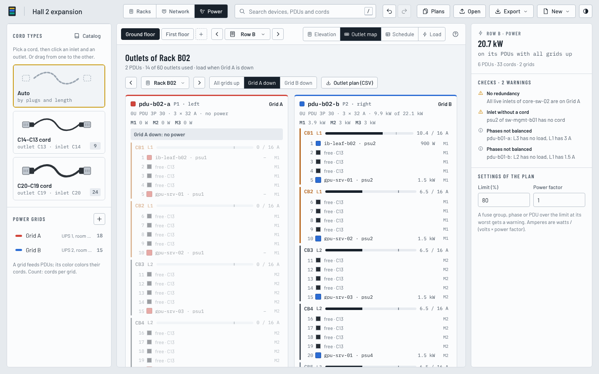
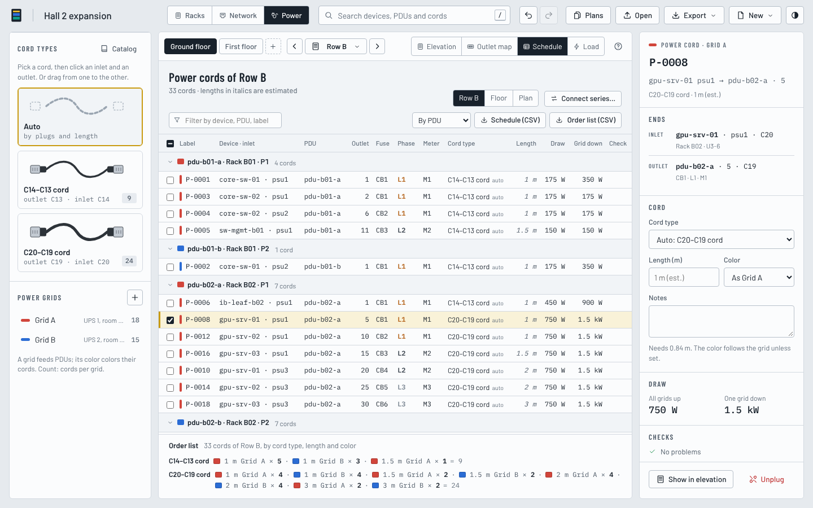
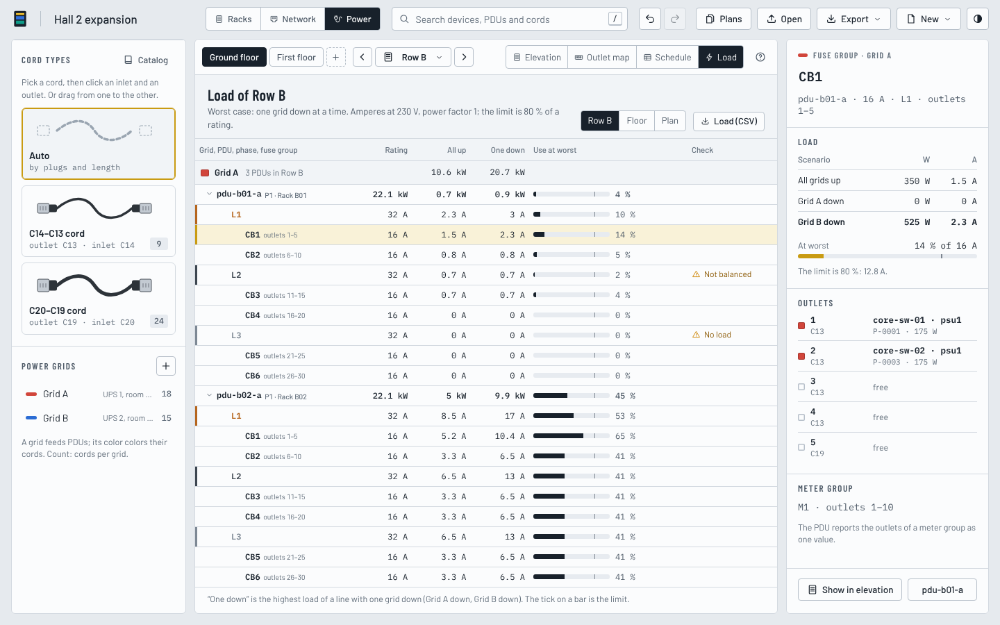

# Power cabling: design

Rackplanner plans the power cabling of a plan in its own **Power**
workspace, next to the **Racks** workspace that places devices and the
**Network** workspace that connects their network ports. Device types get
named **inlets** with a power connector; **vertical PDUs** hang in the
**PDU slots** of the racks, with outlets in fuse groups and meter groups;
each PDU is fed by a **power grid**; **power cords** join an inlet of a
device to an outlet of a PDU in the same rack; and a catalog of **cord
types** says what can be bought, in which lengths.

This document is the design the implementation follows, with the decisions
taken while building it at the end. The screenshots show the views as they
are built, on Row B of the example plan; the
[README](../../README.md#planning-the-power) says how to use them.

Network cabling and power cabling stay apart. They share the devices, the
racks and the views; the Network workspace, its cables and its CSVs do not
show power cords.

## 1. Data model

Power cabling came with version 6 of the plan file; the README's
[data model](../../README.md#data-model) describes the current version.
Everything new is optional when reading: a version 5 file opens with two
empty PDU slots per rack type, the standard inlets on the standard device
types, the standard cord types, and no grids or cords.

| Addition | Where | Like the existing |
| --- | --- | --- |
| `inlets` | each device type | `ports` |
| `pdu` | a device type that is a vertical PDU | |
| `pduSlots`, `defaultPdu` | each rack type | `sideSlots` |
| `loc.kind: "pdu"` | a PDU, `at` is its PDU slot | `loc.kind: "side"` |
| `grid` | each PDU, or `null` | a cable's `network` |
| `powerGrids` | top-level list | `networks` |
| `powerSettings` | top level: `powerFactor`, `limitPct` | `info` |
| `cordTypes` | top-level catalog | `cableTypes` |
| `powerCords` | top-level list | `cables` |



### Inlets

A device type lists its inlets in groups, like its ports: `psu` with
`first` 1 and `count` 2 is `psu1` and `psu2`, and a group with neither is
one inlet named `name`. A type has up to 8 inlets. The standard device types
have two C14 inlets, the GPU server template four C20.

```json
"inlets": [{ "name": "psu", "first": 1, "count": 2, "connector": "c14" }]
```

Power connectors are apart from the network connectors. Inlets take `c14`,
`c20`, `c6` and `c16`, outlets `c13`, `c19`, `c5` and `c15`, and `nema-5-15`,
`nema-l6-30` and `schuko` go on both. Each has a rating in amperes.

### PDUs, outlets, fuse groups and meter groups

A device type with a `pdu` block is a **vertical PDU**: 0U high, with no
inlets of its own. The block has the PDU's length along the rack (`spanU`),
its phases (1 or 3), the voltage per phase, the current per phase, and its
outlets in groups like inlets. An outlet group without a name numbers its
outlets (`1` … `30`).

- A **fuse group** has a name, a rating in amperes, a phase and the names of
  its outlets. Every outlet is in one fuse group.
- **Metering** says what the PDU reports: every outlet, groups of outlets,
  or its inlet only. With `group`, the meter groups name their outlets, and
  every outlet is in one.

A PDU type has up to 96 outlets, 48 fuse groups and 48 meter groups. Three
templates come with the app: a single-phase PDU with 20 × C13,
a three-phase PDU with 24 × C13 and 6 × C19 in six fuse groups of 16 A and
three meter groups, and a three-phase PDU with 24 × C13 metered per outlet.

### PDU slots and grids

A rack type lists its **PDU slots** by side, seen from the front:
`["left", "right"]` is P1 on the left and P2 on the right, and a second
slot on a side is further in. A rack type has 0 to 4 slots, and may name a
**default PDU** type: a new rack of the type gets one PDU per slot. A PDU
sits at `"loc": { "rack": "r4", "kind": "pdu", "at": 0 }`; a PDU slot takes
one vertical PDU and nothing else, and is apart from the units and the side
slots.

A **power grid** is a feed: a name, a color and a note, such as the UPS
behind it. A PDU names its grid, or none. New PDUs of a rack take the grids
in turn, slot 1 the first grid and slot 2 the second, and are named by rack
and slot (`pdu-a01-a`, `pdu-a01-b`). A plan has up to 12 grids.

### Cords

A cord joins one inlet of a device to one outlet of a PDU in the same rack.

```json
"powerCords": [
  { "id": "pc-1", "label": "P-0001", "type": null, "lengthM": null, "color": null, "notes": "",
    "inlet": { "device": "ex-40", "inlet": "psu1" }, "outlet": { "device": "ex-44", "outlet": "1" } }
]
```

`type: null` picks the cord type: the first of the catalog whose plugs fit
the outlet and the inlet, one with a stock length that reaches first.
`lengthM: null` estimates the length, and `color: null` is the color of the
PDU's grid. Labels continue the series `P-0001`; a label can be anything.

The plan never holds:

- a PDU outside a PDU slot, another device in one, two PDUs in a slot, or a
  PDU in a slot its rack type does not list;
- a cord between two racks;
- a cord on a device, inlet or outlet that does not exist, or a second cord
  on an inlet or an outlet;
- a fuse group or meter group that names an outlet the PDU does not have,
  or an outlet in two fuse groups or two meter groups;
- a cord type that is not in the catalog, or a grid that is not in
  `powerGrids`.

The app refuses these, and an import drops them with a warning.

### Length

The outlets of a PDU are spread evenly along it, the first at the top, and
the PDU is centered on the height of the rack. The needed length is

- the height between the inlet (the middle of the device, 44.45 mm per
  unit) and the outlet,
- plus 0.3 m across to the channel at the side,
- plus 0.15 m of slack at each end.

The cord's length is the length decided, or else the needed length rounded
up to the type's next stock length, or to 0.1 m for a type made to length.

### Load

The load is worked out for every scenario: **all grids up**, and each grid
**down** in turn.

```
share(inlet)     = power of the device / number of its live inlets with a cord
load(fuse group) = sum of share(inlet) over the cords on its outlets
amperes          = watts / (volts per phase × power factor)
```

An inlet is live when its cord goes to a PDU with power: with all grids up
every corded inlet, with Grid A down those on the PDUs of the other grids.
A PDU without a grid always has power. A device with one cord on each of
two grids draws half on each, and all of it on one while the other is down;
a device whose cords are all on the grid that is down is off.

A phase carries the load of its fuse groups, and a PDU that of its phases.
Each is held against a rating:

| Level | Rating |
| --- | --- |
| Fuse group | its `ratingA` |
| Phase | the PDU's `maxA` |
| PDU | phases × `voltageV` × `maxA` × power factor, in watts |
| Grid | none: a grid is a sum, in watts |

The **worst** value of a line is its highest in any scenario, and the use
at worst is that as a share of the rating. The plan's `powerSettings` hold
the power factor (1 by default) and the limit (80 % by default).

### Checks

Problems are warnings that stay until fixed, as for cables:

| Check | Example |
| --- | --- |
| Fuse over the limit | CB2 of pdu-a02-a: 14.3 A of 16 A when Grid B is down |
| Phase or PDU over the limit | L1 of pdu-b02-a: 27.1 A of 32 A when Grid A is down |
| Outlet over its rating | C13 outlet, 10 A: P-0007 carries 12 A when Grid B is down |
| Plug does not fit | C20–C19 cord on a C14 inlet on a C13 outlet; or no cord type joins them |
| Cord too short | needs 1.4 m, the cord is 1 m |
| No stock length | needs 3.4 m, the longest C14–C13 cord is 3 m |
| No redundancy | all live inlets of cn-005 are on Grid A |
| PDU without a grid | pdu-a03-a: its load counts under “No grid” |
| Inlet without a cord | psu2 of cn-007 has no cord |
| No inlets | type “BMC switch” draws 60 W, but has no inlets |
| Phases not balanced (note) | pdu-a01-a: L3 has no load, L1 has 20.4 A |

An outlet is over its rating when its cord carries more than the outlet's
connector or the cord type allows. A device has no redundancy when it has
two or more corded inlets and all are on one grid. An inlet without a cord
counts in a rack that has a PDU. Phases are not balanced when one has less
than half the load of the highest. Grids have no capacity, so there is no
check on a grid.

### What changes do to cords

| Change | Effect |
| --- | --- |
| Moving a device in its rack | Its cords stay; estimated lengths follow. |
| Moving a PDU to another slot of its rack | Its cords stay. |
| Moving a device or a PDU to another rack | Its cords are unplugged. The app asks first and names them. |
| Deleting a device or a PDU | Its cords go. Several devices that take cords ask first, and the question and the message count the cords. |
| Changing a type's inlets or outlets | Cords keep their inlet and outlet by group and place in the group, as cables keep their ports. Fuse and meter groups keep their outlets by name. |
| Changing a device's type | Cords move to the inlet at the same place in the new type; the others are unplugged. The app asks first and names them. |
| Deleting a power grid | Its PDUs stay, without a grid. |
| Deleting a cord type | Refused while a cord names it. |
| Duplicating devices, a rack, a row or a floor | Cords between copied devices are copied, with labels that continue their series. A copied PDU keeps its grid. |
| New plan from this layout | No devices, so no PDUs, cords or grids; the catalogs stay. |

### Order list and exports

- **Order list**: for each cord type its lengths, by color, with counts.
  Cords are often bought in the color of the feed, so a color is the name
  of a grid, or a cord's own. As CSV too.
- **Power cord schedule CSV**: one line per cord with label, grid, cord
  type, length and whether it is estimated, the floor, row, rack, name,
  position and inlet of the device, the PDU with slot, outlet, fuse group,
  phase and meter group, the draw with all grids up and at most with one
  grid down, color, notes and the IDs of both. **Open** reads it back into
  the current plan: devices by ID, else by name and place, the PDU in the
  device's rack first. Hand-made schedules work with Device, Inlet, PDU and
  Outlet columns alone.
- **PDU outlet plan CSV**: one line per outlet of every PDU, free ones too,
  with connector, fuse group and rating, phase, meter group and what is on
  it: to set up a PDU and its monitoring. It is written only: Open refuses
  it and points to the cord schedule.
- **Power load CSV**: one line per grid, PDU, phase and fuse group, with a
  column per scenario, the worst case, its share of the rating and the
  check that fails.
- **CSV inventory**: a PDU has the position `PDU P1` and a **Power grid**
  column; both are read back.
- **PNG and SVG** of the power elevation from the rear, with a legend of
  the grids; printed sheets of it for each row (**Power rear**).

## 2. The Power workspace

The switch in the top bar is **Racks | Network | Power**. <kbd>C</kbd> steps
through the three workspaces and <kbd>P</kbd> goes to Power. Floor tabs and
the row picker are shared; everything else is the workspace's own.

- **Left panel**: cord types (and **Auto**) to connect with; power grids
  below, to add, rename, recolor, annotate and delete, each with an eye that
  hides its cords in the elevation and the number of cords on it. When a
  device type draws power but has no inlets, the panel says so, with a
  button that gives it `psu[1-2]` C14.
- **Views**: Elevation, Outlet map, Schedule, Load.
- **Connecting**: click an inlet and then a free outlet of a PDU in the
  same rack, or the outlet first, or drag from one to the other; Esc
  cancels. What the plan never holds is refused with the reason. **Connect
  series** gives every free inlet of a device, or of the devices the
  schedule shows, an outlet: inlet 1 on the first PDU of the rack, inlet 2
  on the second and so on, on the fuse group with the least load, and lists
  the cords before it makes them. An inlet goes to the grid that feeds
  its device the least, so a device with a cord gets its other inlet on
  another grid; an inlet that finds no free outlet there is left out,
  with the reason.
- **Inspector**: the checks of the row and the plan's limit and power
  factor when nothing is selected; a device with its inlets and where each
  one goes; a PDU with its grid and the load of its phases and fuse groups;
  a fuse group with its load in every scenario and its outlets; a cord with
  its label, type, length, color, notes and checks; several cords at once.
- **Search** finds PDUs and cords as well as devices.

### Elevation

<picture>
  <source media="(prefers-color-scheme: dark)" srcset="../screenshots/power-elevation-dark.png">
  
</picture>

The current row from the rear (the default; the racks run right to left) or
the front. Every rack has a channel at each side with its PDUs as strips,
in the color of their grid, each outlet a mark at its height. Devices show
their inlets, in the color of the grid that feeds them once they have a
cord. From the rear, a cord runs from its inlet into the channel and along
it to its outlet, in the color of its grid. The front shows the
devices and the PDUs without cords. A selected device, PDU or cord is drawn
bold with the far ends named, and the footer has a legend of the grids.

### Outlet map



The PDUs of a rack, drawn large: outlets from the top down in their fuse
groups, each with its connector, the device and inlet on it, what it draws
and its meter group; a bar per fuse group with its load against its rating
and a tick at the limit; and the totals of each meter group. A switch picks
the scenario. A click on a free outlet starts a connection, one on a used
outlet selects its cord, and one on the head of a fuse group selects it.

### Schedule



Every cord as a table, grouped by PDU, device, grid or cord type, for the
row, the floor or the plan, with a filter, the checks, and the order list
underneath.

### Load



Grid, PDU, phase and fuse group as a tree, for the row, the floor or the
plan: the rating, the load with all grids up, the highest load with one grid
down, and a bar of the use at worst with a tick at the limit. A line over
the limit is flagged, and so is a phase that is not balanced.

### In the Racks workspace

- A rack is drawn with a channel at each side for its PDU slots; a PDU is a
  strip in the color of its grid, and the rack's line counts the slots taken
  (**PDU 2/2**).
- A vertical PDU type is dragged onto a rack like any device; the placement
  dialog asks for its slot and its grid. **Fill PDU slots**, on a rack, a
  row or a floor, hangs a PDU in every free slot.
- The inspector of a PDU sets its grid, and opens it in Power.
- The catalog gets inlets on the **Ports** tab of device types, an
  **Outlets** tab on vertical PDU types (outlets, phases, voltage, current,
  fuse groups, metering), PDU slots and the default PDU on rack types, and a
  **Cord types** tab. **Make vertical PDU** turns a 1U PDU type into a
  vertical one and moves its devices from the side slots to PDU slots.
- The Outlets tab draws the PDU as a strip, its outlets in their fuse
  groups. A drag across outlets picks them, and so do clicks (Ctrl for one
  more, Shift for all up to it) and the keyboard (arrow keys, Space);
  **Group them** puts the outlets picked into a new fuse or meter group, or
  into one there is. They leave the groups they were in, and a group left
  without outlets is gone. The tables under the strip take the outlets of a
  group as a typed list.
- A change of a device's type, a delete and a copy of several devices
  treat power cords as they treat cables: the question names or counts the
  cords that would go, and a copy of devices with their PDUs copies the
  cords between them.
- The floor map's meters get **At worst**: the highest use of a fuse
  group, phase or PDU of each rack, in its worst scenario.
- The CSV inventory lists a PDU at `PDU P1`, with its grid.

## 3. Decisions

Taken while building, where the design left a detail open:

1. A cord stays in its rack. Feeds from a PDU in a neighbouring rack are
   not modelled.
2. A cord whose plugs do not fit is kept, with the check **Plug does not
   fit**: only what the plan never holds is refused.
3. The worst case of a line is its highest load in any scenario, all grids
   up included, so a plan with one grid has a worst case too.
4. A PDU without a grid always has power, and its load counts under
   **No grid**.
5. Grids have no capacity. A grid's line in the Load view is a sum.
6. **No redundancy** needs two corded inlets on one grid; a device with one
   inlet is not flagged. **Inlet without a cord** counts only in racks that
   have a PDU, so a row not planned yet stays quiet.
7. The front of the elevation shows no cords: they run at the rear.
8. PNG, SVG and print give the rear elevation from every view of Power.
9. A version 5 file keeps its 1U PDUs in the side slots. The step that reads
   it adds empty PDU slots and no PDUs, and gives inlets to the standard
   device types only.
10. Reading a cord schedule back keeps what was picked: a cord type marked
    `(auto)` and a length marked as estimated are picked again.
